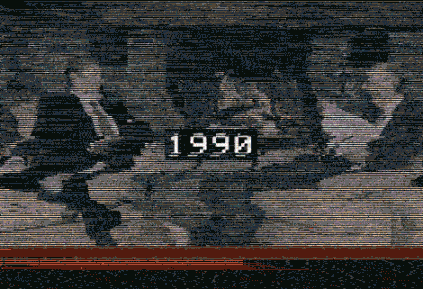

  

 

# BL4CKSP4C

Data Analyst focused on data engineering, process automation, and system security.

---

### 💻 Tech Stack & Tools

* **Languages:** Python, SQL, Scala, R, PowerShell, Bash, VBA, DuckyScript, VBA and many others...
* **Data & Analytics:** PySpark, Scikit-learn, TensorFlow, Qlik Sense, dataViz ... 
* **Databases:** SQLite, MySQL, MongoDB, Hive/HDFS
* **Infrastructure & Ops:** Linux, Docker, Git, Tailscale, Self-Hosted Services

---

### 🛠️ Hardware Lab & Gear

*"Hack the planet"*

* 🐬 **Flipper Zero** (RFID/NFC clone, Sub-GHz sniffing & BadUSB scripts — Momentum firmware, ESP32 GPIO)
* 🍍 **Hak5 Tools** (WiFi Pineapple Mark VII & Pager, USB Rubber Ducky)
* 📻 **SDR / HackRF One** (PortaPack H4M, Mayhem firmware, radio signal analysis & spectrum monitoring)
* 🔑 **iCopy-XS** (RFID/NFC duplicator & key dictionary analysis — Open Iceman firmware)
* 💻 **Medicar / Rescue Media** (MediCat USB diagnostics & offline analysis toolkit)

